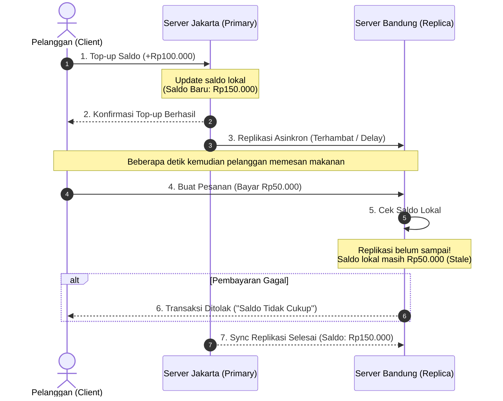
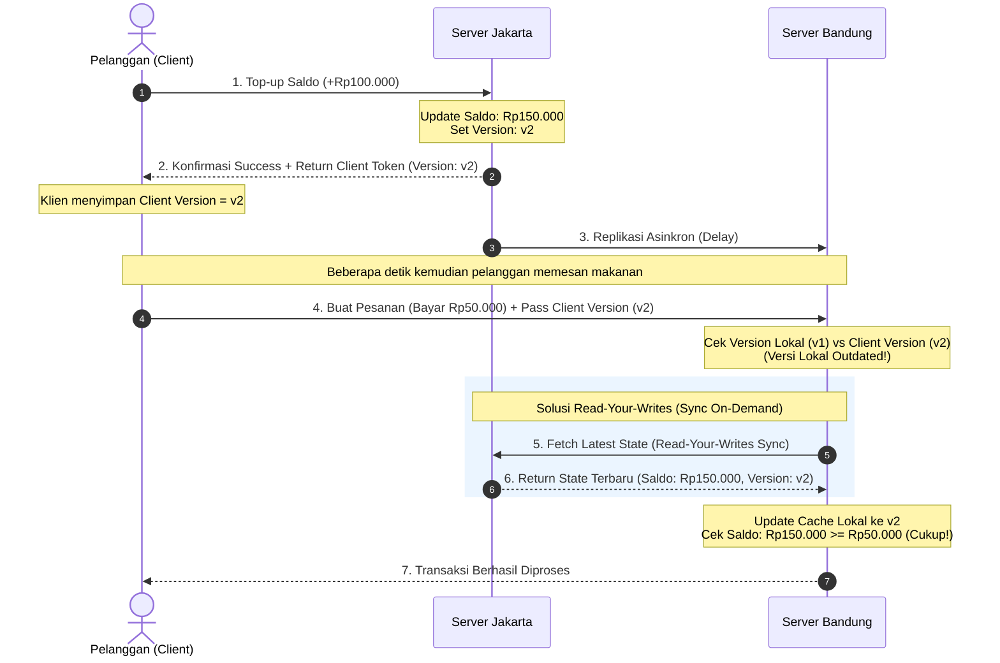

# Tugas 6 — Konsistensi Data

**Kelompok:** [PaperRex]

| Nama | NIM | Kontribusi |
|---|---|---|
| [Rizqullah Izzul Ibad Gheaz] | [103072400033] | [SRC & Testing] |
| [Habhindra Dzaky Alghifary] | [103072400095] | [Diagram Mermaid] |
| [Muhammad Zaki Oktaruna] | [103072400001] | [ ... ] |

## 1. Diagram

1.Skenario Bug Happens

2.Skenario Skenario Solusi Client-Centric
Skenario ini menunjukkan perbaikan menggunakan mekanisme **Read-Your-Writes (RYW)**. Klien menyimpan *version token/timestamp* setelah melakukan pembaruan saldo di Jakarta. Saat bertransaksi di Bandung, server Bandung menyadari versi lokalnya lebih lama (*outdated*) sehingga melakukan *fetch* data terbaru langsung ke Jakarta sebelum memproses transaksi.

## 2. Analisis

### 1. Penentuan Model Konsistensi (Sequential vs Eventual) & Dampak Bisnis
Kesimpulan: Eventual Consistency murni TIDAK CUKUP untuk skenario saldo e-wallet FoodGo

Argumen Berbasis Dampak Bisnis:
1. Sensitivitas Finansial vs Aktivitas Sosial (Low-Stakes vs High-Stakes):
    - Sosial Media (Like/Comment): Menggunakan Eventual Consistency. Jika jumlah like terlambat ter-update beberapa detik antara pengguna A dan B, tidak ada kerugian finansial atau dampak sistemik terhadap pengguna
    - E-Wallet (Finansial): Mengolah nilai ekonomi nyata. Ketidaksesuaian data walau hanya berdurasi 2 detik (replication delay) langsung berdampak pada penolakan transaksi (False Rejection)
2. Dampak Operasional dan Kepercayaan Pelanggan (User Experience & Retention):
    - Pengalaman Pengguna Buruk (User Frustration): Pelanggan baru saja memindahkan saldo dari bank ke e-wallet di server Jakarta, namun transaksinya ditolak di server Bandung dengan pesan "Saldo Tidak Cukup"
    - Kehilangan Kepercayaan (Loss of Trust): Pelanggan akan merasa uangnya hilang atau aplikasi mengalami kegagalan fungsi (buggy). Hal ini memicu lonjakan tiket pengaduan ke Customer Service (meningkatkan operational cost) dan memicu perpindahan pengguna (churn rate) ke platform kompetitor
3. Risiko Double Spending:
    - Jika sistem mengizinkan pembacaan saldo lama di server Bandung, ada celah di mana pengguna dapat membelanjakan saldo yang seharusnya sudah terpotong atau diproses di tempat lain sebelum proses replikasi antar-server selesai.

### 2. Usulan Pendekatan Client-Centric Consistency (Read-Your-Writes)
Mengingat memaksakan Sequential Consistency secara global ke seluruh server/replika akan memicu latency tinggi dan menurunkan ketersediaan sistem (availability), pendekatan terbaik adalah mengombinasikan Eventual Consistency pada latar belakang (background replication) dengan jaminan Client-Centric Consistency, khususnya Read-Your-Writes (RYW) Consistency untuk akses dari klien.

Mekanisme Kerja Solusi (Read-Your-Writes):
1. Pemberian Version Token / Timestamp:
    - Setiap kali pelanggan melakukan aksi penulisan data (top-up atau pemotongan saldo) di server Jakarta, server akan meningkatkan versi data pengguna (version) dan mengembalikan token versi tersebut (Client Version = v2) bersama dengan respons sukses ke aplikasi client.
2. Penyimpanan State di Klien:
    - Aplikasi mobile pelanggan menyimpan nilai Client Version = v2 secara lokal
3. Validasi Versi & Sync On-Demand Saat Transaksi:
    - Ketika pelanggan membuat pesanan di server Bandung, aplikasi akan menyertakan Client Version = v2 dalam header request.
    - Server Bandung membandingkan versi lokalnya (v1) dengan Client Version milik klien (v2).
    - Aksi jika outdated: Karena versi lokal Bandung tertinggal (v1 < v2), server Bandung tidak menolak transaksi, melainkan melakukan on-demand fetch / redirect bacaan data terbaru secara instan ke server Jakarta (Master).
    - Setelah mendapatkan data saldo terbaru (v2), transaksi diproses dan dinyatakan berhasil.

Keuntungan Solusi: 
1. Bagi Klien (Pelanggan): Selalu melihat dan menggunakan hasil penulisan (write) terbarunya sendiri secara instan tanpa pernah mengalami inconsistent read.

2. Bagi Sistem (Infrastruktur): Replikasi antar-server tetap dapat berjalan secara asinkron (menghemat bandwidth dan menurunkan latensi secara umum), sementara lalu lintas on-demand sync hanya terjadi saat ada ketidaksesuaian versi klien.
