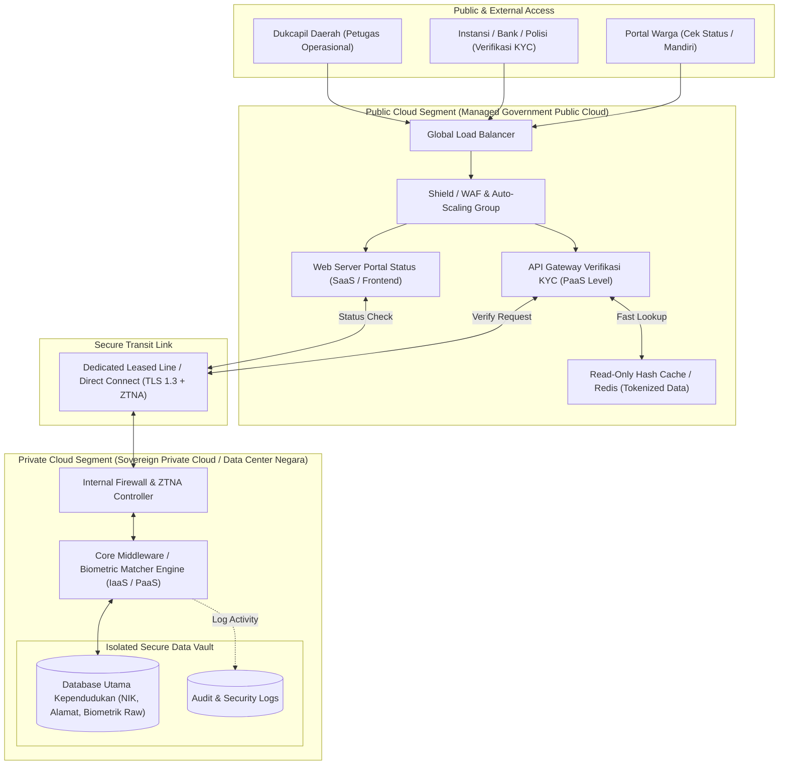
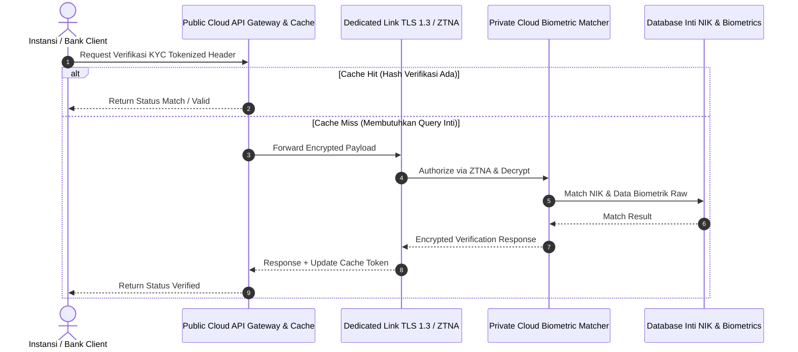

# Tugas 6— Penamaan DHT

**Kelompok:** [PaperRex]

| Nama | NIM | Kontribusi |
|---|---|---|
| [Rizqullah Izzul Ibad Gheaz] | [103072400033] | [Analisis] |
| [Habhindra Dzaky Alghifary] | [103072400095] | [Testing] |
| [Muhammad Zaki Oktaruna] | [103072400001] | [No 1 dan 3] |

## 1. Rekomendasi Deployment Model: Hybrid Cloud [Zaki]
Berdasarkan analisis ketegangan arsitektural antara tuntutan kedaulatan data mutlak dan elastisitas akses massal, model penyebaran yang paling tepat Hybrid Cloud. Arsitektur ini memisahkan beban kerja secara tegas ke dalam dua segmen terintegrasi: 
- Segmen Private Cloud (Pusat Data Nasional): Dikelola dan dikendalikan sepenuhnya oleh pemerintah untuk menyimpan basis data inti kependudukan (NIK, biodata, dan template biometrik) serta menjalankan mesin pencocokan identitas internal
- Segmen Public Cloud (Lapisan Antarmuka & Komputasi Publik): Berfungsi sebagai lapisan pemrosesan tanpa penyimpanan permanen (stateless compute layer) yang menampung API Gateway, penyeimbang beban (load balancer), dan antarmuka verifikasi bagi ribuan instansi mitraSegmen Public Cloud (Lapisan Antarmuka & Komputasi Publik): Berfungsi sebagai lapisan pemrosesan tanpa penyimpanan permanen (stateless compute layer) yang menampung API Gateway, penyeimbang beban (load balancer), dan antarmuka verifikasi bagi ribuan instansi mitra
## 2. Diagram Ring Topology
1. Rekomendasi Deployment Model & Arsitektur Utama

2. Alur Verifikasi Data & Keamanan

## 3. Analisis Risiko Spesifik & Strategi Mitigasi [Zaki]
Penerapan Hybrid Cloud pada sistem identitas nasional menghadirkan tantangan spesifik terkait perlindungan data kependudukan dan akurasi status warga negara:

Risiko 1: Kebocoran Template Biometrik & Rekonstruksi Identitas pada Jalur Verifikasi KYC
- Skenario Risiko: Saat perbankan atau kepolisian melakukan verifikasi wajah maupun sidik jari secara massal melalui segmen Public Cloud, pengiriman data biometrik mentah melintasi batas jaringan (public-to-private) berisiko mengekspos data biometrik warga. Berbeda dengan kata sandi, data biometrik bersifat permanen seumur hidup dan tidak dapat diganti apabila bocor
- Strategi Mitigasi: Menerapkan Cancelable Biometrics & Feature Extraction di Sisi Klien sebelum permintaan dikirim ke Public Cloud, melalui jalur privat terenkripsi (Dedicated Leased Line dengan Mutual TLS). Proses pencocokan (biometric matching) dilakukan sepenuhnya di dalam Private Cloud negara, sedangkan Public Cloud hanya meneruskan vektor terenkripsi dan mengembalikan skor kecocokan (match score) tanpa pernah menyimpan citra wajah atau NIK mentah

Risiko 2: Inkonsistensi Status Kependudukan (Data Kematian/Perubahan NIK) Saat Lonjakan Pemilu atau PPDB
- Skenario Risiko: Pembaruan data penduduk (seperti pencatatan kematian, perubahan domisili, atau status hak pilih oleh Dukcapil daerah) berlangsung langsung di Private Cloud. Apabila lapisan cache pada API Gateway di Public Cloud terlambat tersinkronisasi saat beban akses memuncak, identitas penduduk yang sudah tidak berlaku berpotensi lolos proses verifikasi pemilu atau seleksi sekolah
- Strategi Mitigasi: Menerapkan mekanisme Event-Driven Cache Invalidation berbasis Change Data Capture (CDC) dari basis data inti di Private Cloud menuju lapisan API Gateway. Setiap perubahan status krusial warga negara secara otomatis memicu penghapusan token verifikasi lama dalam hitungan milidetik (near real-time) tanpa perlu mentransfer rincian data pribadi ke segmen publik
