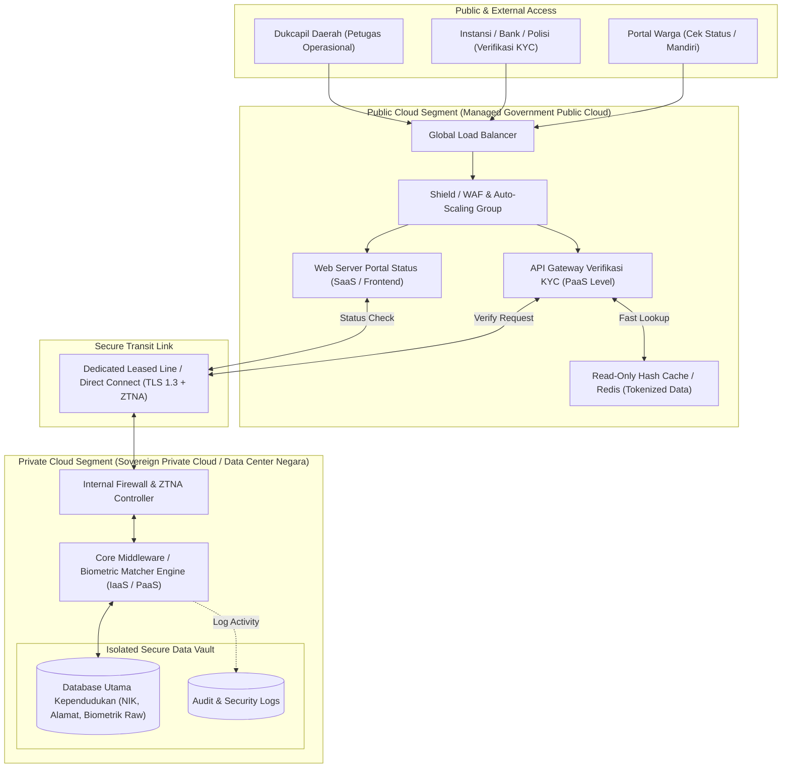
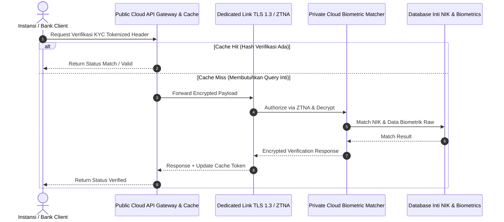

# Tugas 6— Penamaan DHT

**Kelompok:** [PaperRex]

| Nama | NIM | Kontribusi |
|---|---|---|
| [Rizqullah Izzul Ibad Gheaz] | [103072400033] | [Analisis] |
| [Habhindra Dzaky Alghifary] | [103072400095] | [2. Diagram ] |
| [] | [] | [] |

## 1. Rekomendasi Deployment Model: Hybrid Cloud []

## 2. Diagram Ring Topology
1. Rekomendasi Deployment Model & Arsitektur Utama

2. Alur Verifikasi Data & Keamanan

