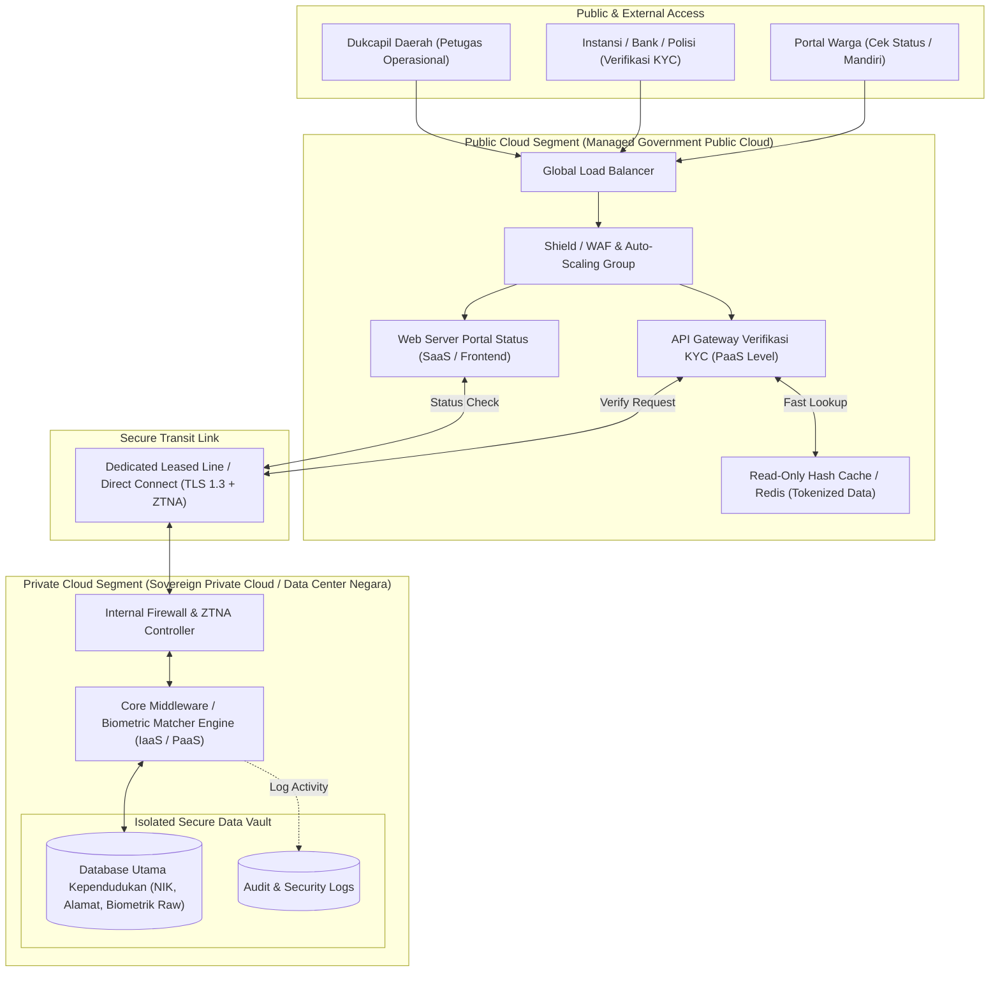
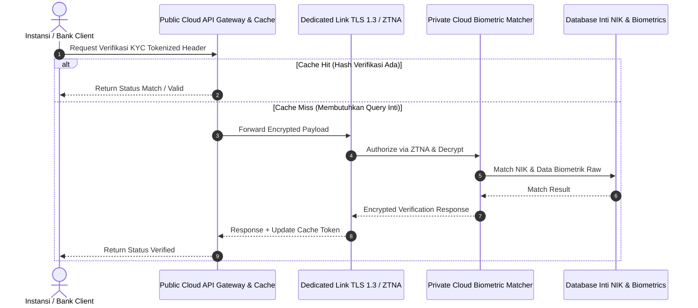

# Tugas 9 - Cloud Delivery Deployment

**Kelompok:** [PaperRex]

| Nama | NIM | Kontribusi |
|---|---|---|
| [Rizqullah Izzul Ibad Gheaz] | [103072400033] | [Risiko & Mitigasi, Alternatif Ditolak, Skenario Tandingan, & Jurnal] |
| [Habhindra Dzaky Alghifary] | [103072400095] | [Diagram Ring Topology & Sequence Diagram Verifikasi ] |
| [Efran Gustine Yulianto] | [103072400046] | [Deployment Model (NIST) & Service Model] |

### 1. Rekomendasi Deployment Model: Hybrid Cloud [Efran]
### 1.1 Alasan Memilih Hybrid Cloud Berdasarkan 5 Karakteristik Esensial NIST SP 800-145

Untuk **Sistem Data Kependudukan** yang mengelola data pribadi sangat sensitif (nama, NIK, alamat, dan data biometrik mentah) di bawah mandat **UU Perlindungan Data Pribadi (UU PDP)** sekaligus melayani ribuan instansi (Dukcapil daerah, kepolisian, bank untuk verifikasi KYC) dan portal warga dengan lonjakan trafik tidak merata (seperti musim pemilu atau pendaftaran sekolah), pilihan deployment model yang paling tepat adalah **Hybrid Cloud**.

Model ini memadukan **Sovereign Private Cloud** (data center negara) untuk penyimpanan inti dan pencocokan biometrik dengan **Managed Government Public Cloud** untuk lapisan akses publik, load balancing, caching hash verifikasi, dan auto-scaling, yang dihubungkan melalui jalur terenkripsi (`Dedicated Leased Line / Direct Connect` dengan **TLS 1.3 + ZTNA**). Berikut keterkaitan lima karakteristik esensial **NIST SP 800-145** terhadap kebutuhan studi kasus:

- **On-Demand Self-Service:** Administrator sistem dan tim operasional dapat melakukan *provisioning* kapasitas komputasi serta penyesuaian aturan *auto-scaling* pada segmen *Public Cloud* secara mandiri dan cepat menjelang puncak trafik (pemilu atau pendaftaran sekolah) tanpa menunggu pengadaan server fisik baru, sementara perubahan kapasitas dan kebijakan akses pada *Sovereign Private Cloud* tetap dikendalikan penuh secara internal oleh otoritas negara.
- **Broad Network Access:** Layanan dapat diakses oleh berbagai kelompok pengguna dan sistem eksternal melalui jaringan standar dan antarmuka terkelola—warga mengecek status mandiri lewat **Portal Warga (C1)**, instansi/bank/kepolisian melakukan verifikasi KYC lewat **API Gateway (C2)**, dan petugas **Dukcapil Daerah (C3)** mengakses layanan operasional—dengan perlindungan WAF/TLS di *Public Cloud* dan isolasi ketat ZTNA menuju *Private Cloud*.
- **Resource Pooling:** Pada segmen *Public Cloud*, sumber daya komputasi, jaringan, dan *Read-Only Hash Cache (Redis)* dapat dipooling secara efisien untuk melayani banyak permintaan verifikasi berulang. Sebaliknya, **Database Utama Kependudukan (NIK, Alamat, Biometrik Raw)**, **Audit & Security Logs**, dan **Biometric Matcher Engine** ditempatkan pada **Isolated Secure Data Vault** di *Private Cloud* agar tidak berbagi sumber daya *multi-tenant* komersial yang berisiko terhadap kerahasiaan data kependudukan sesuai UU PDP.
- **Rapid Elasticity:** Pola trafik kependudukan mengalami lonjakan tajam pada periode tertentu (pemilu, pendaftaran sekolah, layanan administratif massal). Segmen *Public Cloud* (`Global Load Balancer`, `WAF & Auto-Scaling Group`, `API Gateway`, dan `Redis Cache`) mampu melakukan *scale-out* cepat saat lonjakan terjadi untuk meredam beban (terutama saat *cache hit*) dan melakukan *scale-in* saat trafik kembali normal, sehingga *Biometric Matcher Engine* dan *Database Utama* di *Private Cloud* tidak langsung tertekan oleh seluruh trafik mentah.
- **Measured Service:** Seluruh pemakaian sumber daya, trafik jaringan, serta volume permintaan verifikasi KYC per instansi dapat dimonitor dan diukur secara terstruktur. Di *Public Cloud*, pengukuran ini mendukung efisiensi alokasi kapasitas elastis serta pembatasan kuota/*rate limiting* per instansi; di *Private Cloud*, pencatatan metrik dan *Audit & Security Logs* memastikan setiap akses ke data inti kependudukan terlacak dan dapat dipertanggungjawabkan secara tata kelola maupun hukum.

### 1.2 Rekomendasi Service Model per Komponen Arsitektur

Berdasarkan diagram arsitektur yang dirancang, pembagian **Service Model (IaaS, PaaS, dan SaaS)** disesuaikan dengan tingkat sensitivitas data kependudukan dan kebutuhan kecepatan layanan tiap komponen:

| Komponen pada Diagram | Segmen Cloud | Service Model | Alasan Pemilihan Service Model |
|---|---|---|---|
| **Database Utama Kependudukan (`PrimaryDB`: NIK, Alamat, Biometrik Raw)** & **Audit & Security Logs (`AuditLog`)** | Private Cloud (`Isolated Secure Data Vault`) | **IaaS** | Menyimpan data pribadi paling rahasia (NIK, alamat, biometrik mentah) dan jejak audit keamanan; IaaS memberi negara kendali penuh atas infrastruktur komputasi, penyimpanan terenkripsi, isolasi jaringan, dan konfigurasi keamanan internal sesuai UU PDP. |
| **Internal Firewall & ZTNA Controller** & **Core Middleware / Biometric Matcher Engine** | Private Cloud | **IaaS** *(dengan orkestrasi/runtime terkelola internal)* | Memproses pencocokan data biometrik dan otorisasi akses inti ke database; IaaS memastikan kontrol ketat atas lingkungan eksekusi, kebijakan jaringan internal, dan keamanan data sensitif di pusat data negara. |
| **API Gateway Verifikasi KYC** & **Read-Only Hash Cache / Redis (Tokenized Data)** | Public Cloud | **PaaS** | Menangani routing API, *rate limiting*, manajemen token verifikasi, dan *cache* hash sementara untuk mempercepat verifikasi KYC; PaaS mempercepat pengelolaan platform, *patching*, dan penskalaan komponen middleware/cache tanpa mengorbankan pemisahan data inti. |
| **Global Load Balancer** & **Shield / WAF & Auto-Scaling Group** | Public Cloud | **PaaS** *(layanan jaringan/keamanan platform terkelola)* | Mengatur distribusi trafik, penyaringan serangan web/DDoS, dan penskalaan otomatis saat lonjakan pemilu atau pendaftaran sekolah secara terkelola agar tim fokus pada kebijakan keamanan dan kapasitas. |
| **Web Server Portal Status (`Portal Warga` & akses antarmuka layanan `Dukcapil Daerah`)** | Public Cloud | **SaaS** *(aplikasi layanan siap pakai / terkelola penuh)* | Menyediakan antarmuka layanan status kependudukan dan operasional berbasis web yang siap pakai bagi masyarakat dan instansi daerah tanpa mengharuskan tiap instansi mengelola server aplikasi sendiri. |

## 2. Diagram Ring Topology [Habhindra]
1. Rekomendasi Deployment Model & Arsitektur Utama

2. Alur Verifikasi Data & Keamanan

## 3. Analisis Risiko Spesifik & Mitigasi [Ibad]
Dalam arsitektur Hybrid Cloud untuk Sistem Data Kependudukan (yang menyimpan nama, NIK, alamat, dan data biometrik serta melayani lonjakan verifikasi KYC dari instansi, kepolisian, bank, dan Dukcapil), terdapat dua risiko utama yang spesifik terhadap konteks data kependudukan dan pola beban sistem:   
1. Kebocoran atau Eksploitasi Data pada Read-Only Hash Cache (Redis) di Segmen Public Cloud
- Analisis Risiko: Untuk mempercepat verifikasi KYC saat cache hit, sistem menyimpan hash verifikasi sementara pada Redis di segmen Public Cloud. Meskipun data mentah biometrik dan database utama berada di Sovereign Private Cloud, segmen Public Cloud memiliki permukaan serangan (attack surface) yang lebih luas karena terpapar trafik publik dan eksternal. Jika terjadi kompromi pada API Gateway atau cache akibat kerentanan aplikasi maupun replay attack pada tokenized header, penyerang dapat berupaya menebak atau menyalahgunakan token/hash verifikasi milik warga negara.
- Mitigasi:
   - Menerapkan salted cryptographic hashing (seperti Argon2 atau HMAC-SHA256 dengan salt rahasia di sisi Private Cloud) sehingga tidak ada NIK polos maupun data biometrik mentah yang pernah tersimpan di Public Cloud.
   - Menetapkan Time-To-Live (TTL) yang sangat singkat (misalnya 5–15 menit) dan mengikat token dengan konteks permintaan (nonce/timestamp dan identitas instansi peminta) agar tidak mudah direplikasi.
   - Memperkuat lapisan perimeter dengan WAF, rate limiting, mTLS, serta validasi ketat pada Internal Firewall & ZTNA Controller sebelum meneruskan cache miss.   
2. Kegagalan atau Bottleneck pada Dedicated Leased Line saat Lonjakan Akses (Cache Miss Massal)
- Analisis Risiko: Pola akses sistem kependudukan bersifat tidak merata dan mengalami lonjakan tajam pada momen tertentu seperti pemilu atau pendaftaran sekolah. Ketika lonjakan permintaan baru (cache miss) terjadi serentak, jutaan permintaan harus melewati Direct Connect (TLS 1.3 + ZTNA) dari Public Cloud menuju Core Middleware / Biometric Matcher Engine dan Database Utama Kependudukan di Private Cloud. Jika jalur leased line mengalami saturasi kapasitas atau gangguan fisik, seluruh proses verifikasi lintas instansi dapat melambat drastis atau terputus (single point of failure).
- Mitigasi:
   - Menggunakan konfigurasi redundant leased line (multi-homed dengan dua penyedia backbone jaringan terpisah dan automatic failover) agar tidak bergantung pada satu jalur fisik saja.
   - Menerapkan request queueing (antrean terkelola), rate limiting per instansi, dan circuit breaker pada API Gateway agar lonjakan ekstrem tidak membuat Biometric Matcher Engine maupun PrimaryDB kehabisan sumber daya.   
   - Melakukan pencatatan dan pemantauan berkelanjutan melalui Audit & Security Logs untuk mendeteksi anomali trafik maupun kegagalan koneksi secara cepat.   
## 4. Perbandingan dengan Alternatif yang Ditolak [Ibad]
Sebagai pembanding utama, kelompok menolak penggunaan Public Cloud Murni untuk keseluruhan sistem kependudukan.
- Mengapa Public Cloud Murni Ditolak: Public Cloud murni memang sangat unggul dalam menyediakan rapid elasticity dan resource pooling untuk menghadapi lonjakan trafik pemilu atau pendaftaran sekolah tanpa harus membeli banyak perangkat keras di awal. Namun, sistem ini menangani data pribadi warga negara yang sangat sensitif (NIK, alamat, dan data biometrik) yang dilindungi regulasi ketat seperti UU Perlindungan Data Pribadi serta menyangkut kedaulatan dan keamanan nasional. Menempatkan Database Utama Kependudukan dan Biometric Matcher sepenuhnya di infrastruktur milik penyedia Public Cloud komersial mengurangi kendali langsung negara atas infrastruktur fisik, isolasi data, serta kepatuhan hukum lintas yurisdiksi.   
- Keunggulan Pilihan Hybrid Cloud: Dengan Hybrid Cloud, data inti dan pencocokan biometrik tetap berada di bawah kendali penuh negara pada Sovereign Private Cloud, sementara portal status, API Gateway, dan load balancing/auto-scaling memanfaatkan elastisitas di Public Cloud.   
## Skenario Tandingan [Ibad]
- Skenario Tandingan: "Bagaimana jika kantor Dukcapil di daerah atau instansi verifikasi berskala kecil tidak memiliki infrastruktur jaringan privat khusus maupun kapasitas TI yang memadai untuk terhubung ke sistem ini?"   
- Jawaban: Pada arsitektur yang dirancang, instansi seperti Dukcapil Daerah (C3) dan Portal Warga (C1) tidak diwajibkan membangun infrastruktur private cloud atau leased line sendiri untuk mengakses layanan. Akses dilakukan melalui Global Load Balancer dan WAF di segmen Public Cloud dengan koneksi internet standar yang diamankan menggunakan TLS 1.3 serta kontrol akses ZTNA (Zero Trust Network Access). Dengan demikian, instansi daerah cukup menggunakan perangkat klien yang terverifikasi dan autentikasi berlapis (seperti kredensial instansi/MFA) tanpa harus menanggung beban pengelolaan infrastruktur inti di pusat data negara. 